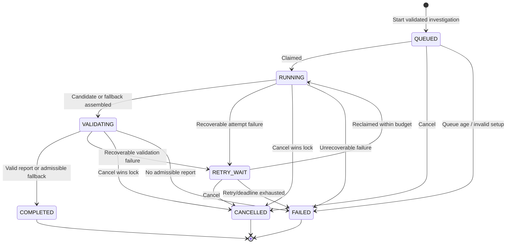

# IncidentPilot v3 spec errata

**Status:** E1–E17 accepted 2026-11-05 (T0.5). E18 accepted 2026-11-08 (T1.3). E19 proposed at T0.7, awaiting sign-off.

The design spec is frozen and its hash is pinned in `MANIFEST.json`, so corrections live here. **Where this file and the spec disagree, this file wins.** Each entry names the spec text it changes.

Entries marked ⚖️ are judgment calls where the spec gave no clear answer. The others follow directly from the spec's own rules.

| # | Topic | Decision in brief | First used |
|---|---|---|---|
| E1 | Recovery during validation | Add `VALIDATING → RETRY_WAIT`; one repair per investigation | T1.2 |
| E2 ⚖️ | Numeric claims | Quantities live in a typed `Measurement`, never in free text | T1.5 |
| E3 | Citation shape | One selector type; everything above evidence cites observation IDs | T1.4 |
| E4 ⚖️ | Causes and outcomes | `root_causes` lists accepted `cause_id`s; rules per outcome | T1.5 |
| E5 | Report schemas | Separate `ReportCandidate` and `DiagnosisReport` | T1.5 |
| E6 | Oracle and publication | Publish `not_assessed`; assess separately, after publication | T1.5 |
| E7 | Snapshot registry | Add a `snapshots` table | T3.2 |
| E8 ⚖️ | Frozen config and mode | Store the values; request mode must match process mode | T3.5 |
| E9 | Closing an attempt | One shared function that also settles the ledger | T3.10 |
| E10 | CLI before the API | CLI calls services directly until IP3-010 | T3.7 |
| E11 ⚖️ | Queue admission | Advisory lock; only `QUEUED` counts toward the 20 | T3.5 |
| E12 | Oracle boundary | Generator moves under `evaluation/` | T2.1 |
| E13 | Per-tool quota | `tool_name` column and a counter table | T3.11 |
| E14 | Evidence dedup | Unique constraint with `ON CONFLICT` | T3.11 |
| E15 ⚖️ | Unit of evidence | Smallest citable source record; a series counts as one | T1.4 |
| E16 | Trace tool | `get_trace_summary` is a fifth P0 tool | T4.4 |
| E17 | Fallback validation | Fallbacks pass through validation; D06 is authoritative | T4.8 |
| E18 ⚖️ | Tool-call states | Tool calls get a state like model calls; sent calls keep their reservation | T1.3 |
| E19 ⚖️ | Owner isolation | Every tenant row has an owner, and PostgreSQL enforces it | T1.4 |

---

## E1. Recovery during validation

**Changes:** D06, §5.2, §2.4 (report repairs), §6.6

**Problem:** D06 has no edge out of `VALIDATING` for a recoverable failure, so a worker that dies during validation, including during the repair model call, can't recover. A recovered attempt could also get a second repair.

**Decision:**
- Add `VALIDATING → RETRY_WAIT`, taken when the lease is lost or validation hits a recoverable failure while attempts and deadline remain.
- The candidate commits in the same fenced transaction as `RUNNING → VALIDATING`.
- On recovery, if a candidate is stored for the investigation, the new attempt goes straight from `RUNNING` to `VALIDATING` on that candidate, with no new model or tool calls.
- `investigations.repair_requests_used` counts repairs, with `CHECK (repair_requests_used <= 1)`. It's incremented in the same transaction that reserves the repair model call, so it survives recovery.

Corrected D06, with one added edge:

## E2. Numeric claims ⚖️

**Changes:** §7.4 `Observation`, §10.1 `impact`, §10.2

**Problem:** `claim` is free text, so the numeric validation stage has nothing it can recompute.

**Decision:**
- Add a `Measurement` submodel: `metric`, `aggregation` (enum), `value`, `unit`, `window`, and `inputs` (evidence selectors). Ratios also carry `numerator` and `denominator`.
- `claim_kind = computed` requires a `measurement`. `claim_kind = observed` must not have one.
- `impact` measurements use the same type.
- **Quantities never appear in model-written free text.** Any number attached to a unit or percent sign in `claim`, `mechanism` or similar fields is rejected, and the application renders the value from the `Measurement`. Identifiers such as `HTTP 503` or `v2` aren't quantities.
- The numeric stage recomputes each `Measurement` from its inputs and compares within a stated tolerance.

**Why this call:** matching numbers in prose back to measurements is fragile. Banning them gives one simple rule and matches the spec's own sample claim, which has no numbers.

**Cost:** the model has to follow a rule it may break, which uses up the single repair. T1.6 tests this against a real model. If the rule proves too strict there, this entry is revisited.

## E3. Citation shape

**Changes:** §7.4 `EvidenceSelector`, §8.2 `evidence_refs`, §10.3 sample

**Problem:** the spec uses three shapes: a structured object, a string like `metric:request_count:18:15`, and observation IDs.

**Decision:**
- `EvidenceSelector` is the only way to point at evidence. It's a union discriminated by `kind`, with a variant per kind in E15. Tool responses return it too, replacing the §8.2 string.
- There are two reference layers:
  - `Observation` and `Measurement` cite **evidence selectors**.
  - `hypotheses`, `alternatives` and `recommendations` cite **observation IDs**, which must resolve within the same report.
- Every claim above the observation layer therefore reaches evidence through a checked observation.

## E4. Causes and outcomes ⚖️

**Changes:** §7.4 `DiagnosisReport`, §10.1

**Problem:** the relationship between `root_causes` and `hypotheses` is undefined, and so are the rules for each outcome. The §10.3 sample is `partially_diagnosed` with no root causes.

**Decision:** `hypotheses[]` holds every candidate cause. `root_causes` is a list of `cause_id`s accepted from it, so nothing is copied and nothing can drift.

| Outcome | `root_causes` | `hypotheses` | `limitations` |
|---|---|---|---|
| `diagnosed` | At least one | Each accepted one has at least one support, and confidence `medium` or `high` | Optional |
| `partially_diagnosed` | May be empty | At least one, with at least one support | Required |
| `insufficient_evidence` | Must be empty | May list what was tested; never in an application-generated report (invariant 9) | Required |

`high` confidence also needs at least two supports citing different evidence IDs, and at least one entry in `alternatives`. This is a structural minimum. Whether the evidence actually supports the mechanism remains a semantic question (E6).

**Why this call:** the spec describes high confidence qualitatively. These thresholds are my concrete floor, and they're easy to tighten later.

## E5. Report schemas

**Changes:** §7.4, §9.1 `CandidateOrStop`, §10.1

**Problem:** one schema covers both model output and the published report, yet the model must not author identity, execution or validation fields (§8.1, §10.1). `CandidateOrStop` is never defined.

**Decision:**
- `ReportCandidate` is the only schema the model sees: `diagnostic_outcome`, `observations`, `hypotheses`, `root_causes`, `impact`, `alternatives`, `recommendations`, `limitations`.
- `DiagnosisReport` wraps a validated candidate with application-written `identity`, `execution` and `validation` sections. `schema_version`, `investigation_id`, `snapshot_id` and `termination_reason` move there.
- `CandidateOrStop` is `Candidate(ReportCandidate) | Stop(reason, detail)`. `reason` is an enum covering refusal, provider failure, turn exhaustion and budget stop.

## E6. Oracle and publication

**Changes:** D13, §10.2

**Problem:** D13 feeds the oracle into the semantic stage before publication. That contradicts §14.4, which keeps the oracle out of the worker, and reports are immutable once published.

**Decision:**
- The worker never assesses semantics. Published reports carry `validation.semantic: not_assessed`.
- Each validation stage reports its own status. A stage that hasn't run says `not_run`, so reports published before the numeric validator exists (M4) can't imply it passed.
- Semantic assessment happens after publication. Results go in a separate `report_assessments` table keyed by `report_sha256`, written only by the evaluator or a human reviewer.
- In D13, read the oracle and human arrows as pointing at that later assessment, not at the pre-publication stage.

## E7. Snapshot registry

**Changes:** §7.2, §12.2, D03

**Problem:** nothing registers snapshots, though start-time validation, the frozen service graph and post-action ancestry all need one. D03 mounts fixtures on workers only, so the API couldn't validate a snapshot.

**Decision:** add a `snapshots` table with `id`, `content_sha256`, `service_graph`, `adapter_version`, nullable `parent_snapshot_id`, and `created_at`. Rows are immutable. `investigations.snapshot_id` is a foreign key to it. An explicit import step fills it from `scenarios/observations`, and the API reads only the table.

## E8. Frozen config and mode ⚖️

**Changes:** §7.2 `investigations`, §12.2, §6.5 claim query

**Problem:** only a config digest is stored, but the worker needs the values. Mode arrives per request, so an offline worker could claim a live job.

**Decision:**
- `investigations` stores the frozen values in typed columns: `mode`, `model_profile`, window, allowed services, and limits. The digest is computed from them.
- Starting an investigation requires the request's `mode` to equal the API process's mode, otherwise it's rejected.
- Workers claim only investigations matching their own mode.
- `replay` never creates an investigation. It reads stored runs, so starting one is rejected.

**Why this call:** a looser rule would let one process serve several modes, but strict matching makes accidental paid calls structurally impossible. The cost is restarting the process to switch modes, which is fine for a local lab.

## E9. Closing an attempt

**Changes:** D08, D09, D14, §6.3, §11.1

**Problem:** D09's cancel branch doesn't close the attempt or release the slot. Neither cancel nor the sweeper touches the ledger, and once the fence rejects a late settlement, a `DISPATCHED` row is stuck forever. D14 also omits the dispatch record that D08 has.

**Decision:** one function, `close_attempt`, runs in the caller's transaction under the investigation row lock. Publication, cancellation, the sweeper and failure handling all use it. It:
1. Sets the attempt's final status.
2. Releases the capacity slot.
3. Moves `DISPATCHED` model calls to `UNKNOWN`, keeping their reservation.
4. Moves `RESERVED` model calls to `FAILED` and releases them, since they were never sent.
5. Treats tool reservations the same way: sent calls keep their quota, unsent ones release it.
6. Appends the event.

`DISPATCHED` must commit **before** the request is sent. That makes `RESERVED` proof of "never sent", while a crash after the commit lands on the conservative `UNKNOWN`. `UNKNOWN` is final: a late response from a stale worker can't settle it.

## E10. CLI before the API

**Changes:** D02, D03, §16.2

**Problem:** Phase 1 needs a CLI, but the HTTP API arrives in Phase 3. Postgres also isn't published to the host, so a host CLI and host tests couldn't reach it.

**Decision:**
- The CLI calls application services directly until IP3-010, then moves to HTTP, restoring D02.
- A dev-only Compose override publishes Postgres on `127.0.0.1`. The default Compose file stays unpublished.
- `owner_id` is a real column from the start. A migration seeds one local owner until auth arrives.

## E11. Queue admission ⚖️

**Changes:** §2.4, §12.2

**Problem:** a `COUNT` under `READ COMMITTED` lets concurrent starts exceed the limit of 20.

**Decision:** after the idempotency check, take `pg_advisory_xact_lock` on a fixed key, then count and insert in the same transaction. Only the start path takes this lock, and it runs before any investigation row exists, so it can't deadlock with the §6.1 lock order.

Only `QUEUED` counts toward the 20.

**Why this call:** the limit bounds work that hasn't begun. `RETRY_WAIT` work has already been admitted and is bounded by attempts and deadline, so counting it would reject new work for no benefit.

## E12. Oracle boundary

**Changes:** §16.4, D03, §14.4

**Problem:** the generator must know oracle labels, but §16.4 puts it in `simulator/`, inside the worker's reach.

**Decision:**
- The generator lives in `src/incidentpilot/evaluation/`, which already has oracle access. `simulator/` keeps only the P1 mutator.
- An import contract forbids every worker-side package from importing `incidentpilot.evaluation`. It's enforced in `make check` from T2.1.
- Worker containers mount `scenarios/observations` only.

## E13. Per-tool quota

**Changes:** §7.2 `tool_calls`, §11.1

**Problem:** per-tool counters have no storage, and `tool_calls` doesn't record which tool ran.

**Decision:** add `tool_calls.tool_name`, with a CHECK over the closed tool set. Add `investigation_tool_quota`, keyed by `(investigation_id, tool_name)`, with reserved and dispatched counts and `CHECK (reserved <= cap)`. Rows are created at start and updated under the investigation row lock. The global cap of 15 stays on the investigation row.

## E14. Evidence dedup

**Changes:** §7.2 `evidence`, §7.3

**Problem:** §7.3 defines the dedup identity, but no constraint enforces it. Evidence is shared across investigations, so one investigation's row lock can't serialize inserts.

**Decision:** add a unique constraint on `(snapshot_id, source_type, source_ref, adapter_version, redaction_version, content_sha256)`. Insert with `ON CONFLICT DO NOTHING`, read back the ID, then grant visibility. All of this stays inside the fenced transaction, so a stale worker's insert rolls back with everything else.

## E15. Unit of evidence ⚖️

**Changes:** §7.2 `evidence`, §7.4, §8.2

**Problem:** nothing says what one evidence row contains, yet that drives selectors, dedup and whether numbers can be recomputed.

**Decision:** one row is the **smallest independently citable source record**, and a time series counts as one record.

| Source | One evidence row | Selector `kind` | Selector narrows by |
|---|---|---|---|
| Metrics | Series for one service, metric, resolution and window | `metric_series_window` | Sub-window |
| Dependency health | Series for one dependency, metric, resolution and window | `metric_series_window` | Sub-window |
| Logs | One log record | `log_record` | Nothing further |
| Deployments | One deployment | `deployment_record` | Nothing further |
| Traces | One span-group summary for a service and window | `span_summary` | Nothing further |

These kinds replace the list in §7.4: `row` is dropped because nothing needs it, and `span_summary` is added for traces. `source_ref` is a canonical string built from those fields. Series points are stored in the row, so the numeric stage can recompute without returning to the source.

**Why this call:** one row per tool response would be simpler, but the same log line returned by two queries would become two pieces of evidence. **Cost:** more rows per log query, bounded by the result limit.

## E16. Trace tool

**Changes:** §8.1, §9.1 `TelemetryProvider`, §16.2

**Problem:** case 1 depends on span timings (§8.3, §14.1), but Phase 2 lists four tools and `TelemetryProvider` has no trace method, so the case may be undiagnosable.

**Decision:** `get_trace_summary` becomes a fifth P0 tool, and `TelemetryProvider` gains `trace_summary`. Cases without trace coverage return `partial` or `empty` with honest coverage.

## E17. Fallback validation

**Changes:** D07, D13, §9.4

**Problem:** D07 and D13 send fallbacks straight to publication, while D06 routes everything through `VALIDATING`.

**Decision:** D06 is authoritative. Application-generated fallbacks go through `VALIDATING` and the same structural and numeric checks. A fallback that fails is a bug in our code, so there's no repair: the investigation ends `FAILED` with a durable summary.

## E18. Tool-call states and reservation effects ⚖️

**Changes:** §7.2 `tool_calls`, §11.1

**Problem:** E9 says sent tool calls keep their quota and unsent ones release it, but `tool_calls` has no state to tell them apart. Its result status comes from the tool's answer, so it's empty for exactly the calls E9 has to close. §11.1 also leaves out E9's `RESERVED → FAILED`, and doesn't say what a failure after dispatch does to the reservation.

**Decision:**
- Add `tool_calls.state`, separate from the result status: `RESERVED → DISPATCHED → COMPLETED|UNKNOWN|FAILED`, plus `RESERVED → FAILED`. `COMPLETED` means the result was persisted as `ok`, `empty` or `partial`. `FAILED` means the tool ended in `error`.
- `DISPATCHED` commits before the adapter is called, and `UNKNOWN` is final, as in E9.
- A physical tool retry stays on the same row, because an invocation is one logical call. A provider retry is a new `model_calls` row, because each one is metered.
- `DISPATCHED → FAILED` keeps the reservation. Only a call that was never sent releases.
- `FAILED` alone doesn't show whether a call was sent, so `model_calls` and `tool_calls` both record `dispatched_at`, set in the transaction that commits `DISPATCHED`. Without it, the investigation's counters couldn't be recomputed from the rows.

Each change has one effect on the reservation:

| Call | From | To | Effect |
|---|---|---|---|
| model | `RESERVED` | `DISPATCHED` | hold |
| model | `RESERVED` | `FAILED` | release |
| model | `DISPATCHED` | `SETTLED` | settle |
| model | `DISPATCHED` | `UNKNOWN` | retain |
| model | `DISPATCHED` | `FAILED` | retain |
| tool | `RESERVED` | `DISPATCHED` | hold |
| tool | `RESERVED` | `FAILED` | release |
| tool | `DISPATCHED` | `COMPLETED` | retain |
| tool | `DISPATCHED` | `UNKNOWN` | retain |
| tool | `DISPATCHED` | `FAILED` | retain |

- **hold:** the call stays reserved while in flight.
- **release:** the request count or quota and the estimate are returned.
- **settle:** the request stays counted, actual usage replaces the estimate, and the rest is returned.
- **retain:** the request or quota stays counted, and so does any estimate.

**Why this call:** a definite provider rejection is probably not billed, but §11.1 only allows a release when the provider was certainly not contacted, and guessing wrong would understate spend. **Cost:** repeated rate-limit errors use up the budget and can stop a run early. That ends in an honest stop rather than an overspend.

## E19. Owner isolation ⚖️

**Changes:** §3.3, §7.2, §7.3, §12.4, D04, D10, E7, E9, E10, E11, E14. §1.4 still excludes multi-tenant hosting.

**Problem:** one owner's data is kept from another's only by checks in each route (§12.4), so one missed filter leaks it. Only `incidents`, `investigations` and `idempotency_requests` have an owner. Snapshots and evidence are shared across owners, and E14's dedup key has no owner. E10 seeds a single owner, so isolation can't even be tested.

**Decision:**

*Invariant.* Add to §3.3: **9. No row belonging to one owner can be read, cited or written in another owner's context. PostgreSQL enforces this, not only application code.**

*Every tenant row has an owner.*
- `owner_id NOT NULL` goes on every table holding tenant data: `incidents`, `investigations`, `attempts`, `model_calls`, `tool_calls`, `investigation_tool_quota`, `snapshots`, `evidence`, `investigation_evidence`, `tool_evidence`, `report_candidates`, `diagnosis_reports`, `report_assessments`, `run_events` and `idempotency_requests`. P1 action tables follow the same rule when they're built.
- Every parent has a unique `(owner_id, id)`, and every child references it by `(owner_id, parent_id)`. That makes a cross-owner reference impossible in the schema itself, including an investigation pointing at another owner's incident, parent investigation or snapshot, and a visibility grant joining one owner's investigation to another owner's evidence.
- Every unique constraint on a tenant table includes `owner_id`. Constraint checks ignore row-level security, so a key without the owner could reveal that another owner's row exists.
- Only `owners`, `capacity_slots` and the migration table have no owner column.

*Snapshots and evidence are per owner.*
- This changes E7 and E14. Snapshots are keyed `(owner_id, id)`, and the import step imports a fixture for a named owner. The same fixture imported for two owners becomes two snapshots.
- E14's dedup key becomes `(owner_id, snapshot_id, source_type, source_ref, adapter_version, redaction_version, content_sha256)`.
- Selectors carry no owner, because the model never sees one. A selector only resolves inside its investigation's owner.

*PostgreSQL enforces it.*
- Row-level security is enabled and forced on every tenant table. The policy is `owner_id = NULLIF(current_setting('app.owner_id', true), '')::uuid` for both reads and writes. An unset owner returns no rows and rejects writes, so a forgotten context fails closed. `NULLIF` matters here because the setting reads back as `''`, not `NULL`, once a transaction that set it has ended.
- The owner is set with `SET LOCAL` at the start of each transaction through one helper, so a pooled connection can't carry it into the next transaction.
- Runtime roles are never superuser, `BYPASSRLS` or table owner. Migrations run as a separate owner role that the API and workers never use.
- Any view is created with `security_invoker = true`, because a plain view runs with its creator's rights and would skip the policy.

*A small, closed set of operations can see every owner.*
- The scheduler has to see every owner, so it gets five `SECURITY DEFINER` functions, each with a pinned `search_path`: admission count (E11), claim selection, expired-lease discovery, slot binding and slot release.
- They return IDs and counts, never tenant content. Slot binding and release check that the attempt belongs to the current owner.
- Adding a function to this set needs an erratum.
- The runtime role has no direct grants on `capacity_slots`.

*Where the owner comes from.*
- **API:** from the authenticated credential. Another owner's resource is reported as not found, so IDs don't reveal what exists.
- **Worker:** from the claimed row. The claim selects a job across owners, then the rest of the same transaction runs with that owner set. That covers the attempt row, epoch, slot binding and event. Every later transaction in the attempt also runs under that owner, including tool calls, evidence, the ledger and `close_attempt` (E9).
- **Sweeper:** finds expired leases across owners, then closes each one under its owner.
- **Never** from model output or tool arguments, which already can't carry an owner (§8.1).

*Testing.* This changes E10: the migration still seeds one local owner, the CLI takes an owner (defaulting to the local one), and the test database always has two owners. Required tests:
- For every tenant table, owner A can't read, change or insert owner B's rows, and a transaction with no owner sees none.
- The composite foreign keys reject every cross-owner reference.
- A worker on A's investigation can't cite B's evidence, even with a valid ID.
- Each scheduler function returns only scheduling fields.
- A catalog check fails the build if any table, unique index, role or definer function breaks the rules above.

*Not included.* Capacity slots and the queue of 20 stay installation-wide, and there are no per-owner spend caps. Real authentication stays with IP3-010.

**Why this call:** the owner goes into keys and foreign keys on every table, so adding it after M3 would mean migrating every table and rewriting dedup. Enforcing it in the database means a missed filter in a route, the gateway or the worker returns nothing instead of another owner's data. **Cost:**
- Wider keys and indexes.
- Fixtures stored once per owner.
- A second access path for the scheduler, in the most delicate code, which needs its own race tests.
- T3.1 grows, and M3 gains one task, T3.14.
